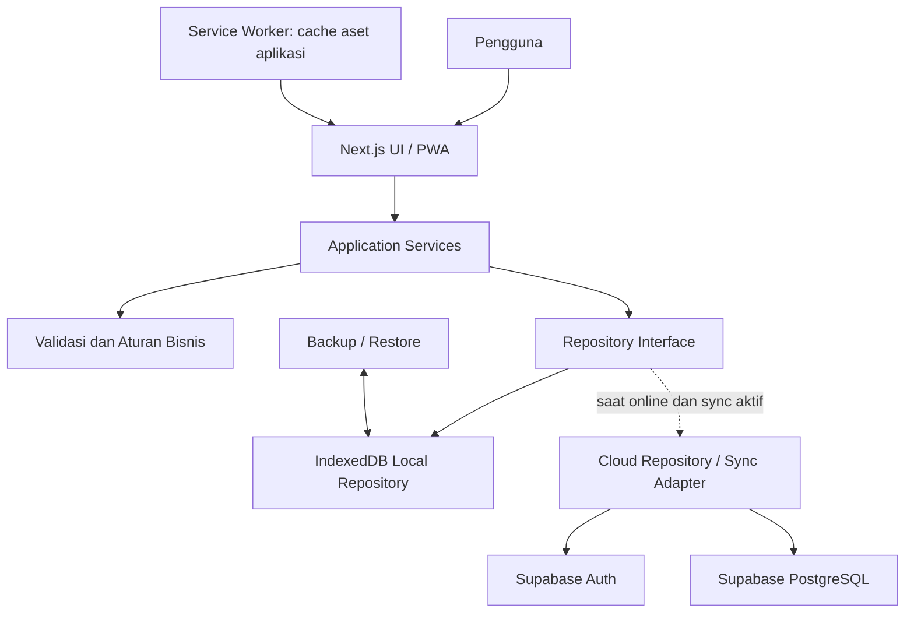

# 02 — Arsitektur Sistem

## 1. Stack yang direncanakan

- Framework: Next.js dengan App Router.
- Bahasa: TypeScript dengan strict mode.
- UI: React dan sistem komponen yang konsisten.
- Validasi: library schema validation seperti Zod.
- Form: React Hook Form atau pendekatan setara.
- Penyimpanan lokal: IndexedDB melalui wrapper seperti Dexie.
- PWA: web app manifest dan service worker melalui solusi PWA yang kompatibel dengan versi Next.js yang dipakai.
- Cloud tahap lanjutan: Supabase Auth, PostgreSQL, dan Realtime bila diperlukan.
- Hosting: Vercel untuk deployment Next.js.
- Pengujian: unit/integration tests dan end-to-end tests.

Versi paket harus dipilih dan dikunci saat project dibuat. Jangan mengasumsikan semua plugin PWA kompatibel dengan setiap versi Next.js; verifikasi kompatibilitasnya sebelum memasang.

## 2. Diagram komponen

## 3. Batas tanggung jawab

### Presentation layer
- Menampilkan halaman, form, daftar, grafik, loading, error, dan status offline/sync.
- Tidak menjalankan query IndexedDB atau Supabase secara langsung.
- Tidak menghitung saldo dengan logika yang tersebar di komponen.

### Application services
- Mengatur use case seperti membuat transaksi, mengubah transaksi, transfer, membuat anggaran, dan membuat backup.
- Menjalankan validasi dan mengelola operasi atomik.
- Menentukan kapan repository dipanggil.

### Repository layer
- Menyediakan interface untuk membaca dan menulis data.
- Implementasi lokal memakai IndexedDB.
- Adapter cloud menangani komunikasi ke Supabase.
- Komponen UI tidak bergantung pada implementasi database tertentu.

### Sync engine
- Mengirim operasi lokal yang belum tersinkron.
- Menggunakan ID stabil, idempotency, retry, dan status sync.
- Tidak menganggap semua konflik dapat diselesaikan dengan last-write-wins tanpa aturan.

## 4. Alur transaksi offline

1. Pengguna mengirim form transaksi.
2. Service memvalidasi nominal, tanggal, akun, kategori, dan ruang lingkup data.
3. Repository menulis transaksi dan catatan antrean sync dalam satu transaksi IndexedDB bila sinkronisasi diaktifkan.
4. UI memperbarui daftar dan saldo dari data lokal.
5. Jika cloud sync aktif dan internet tersedia, sync engine mengirim operasi ke server.
6. Server memvalidasi autentikasi dan hak akses melalui RLS.
7. Operasi yang berhasil ditandai tersinkron; kegagalan tetap ada dalam antrean dengan pesan status.

## 5. Offline dan batasan platform

- Service worker meng-cache shell aplikasi/aset yang dibutuhkan agar PWA dapat dibuka kembali offline.
- IndexedDB menyimpan data transaksi; cache service worker bukan database transaksi.
- Penggunaan offline pertama kali sebelum aplikasi pernah dibuka online tidak dijamin, kecuali distribusi lokal khusus disiapkan.
- Browser dapat membatasi atau menghapus penyimpanan. Karena itu backup/restore wajib.
- Background Sync tidak didukung secara konsisten oleh semua browser. Lakukan sinkronisasi ketika aplikasi dibuka, saat status online berubah, dan melalui tombol manual.
- Hindari menaruh data keuangan sensitif di cache HTTP umum.

## 6. Deployment

- Pengembangan lokal tidak memerlukan GitHub.
- Build dan tes dilakukan lokal terlebih dahulu.
- Saat siap deployment, repo Git dapat dihubungkan ke Vercel untuk deployment otomatis.
- Environment variable publik Supabase boleh berisi URL dan anon/publishable key yang memang dirancang untuk frontend; keamanan tetap wajib ditegakkan dengan RLS.
- Jangan pernah mengirim service-role key ke bundle browser.
