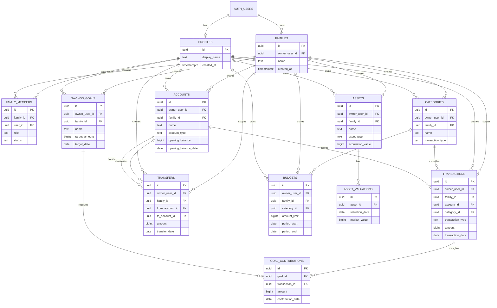

# 08 — ERD Database

ERD ini adalah model target untuk versi cloud. Untuk tahap offline awal, entitas utama yang sama disimpan di IndexedDB. Skema cloud dapat diimplementasikan bertahap; tidak semua tabel harus dibuat pada sprint pertama.

## 1. ERD konseptual

## 2. Penjelasan relasi

- `auth.users` dikelola Supabase Auth; tabel `profiles` menyimpan profil aplikasi.
- `families` adalah ruang lingkup data bersama.
- `family_members` menghubungkan pengguna dan keluarga serta menyimpan role.
- `accounts` menyimpan rekening/sumber saldo pribadi atau bersama.
- `categories` menyimpan kategori transaksi dengan tipe pemasukan atau pengeluaran.
- `transactions` mencatat pemasukan dan pengeluaran.
- `transfers` mencatat perpindahan dana antarakun secara atomik.
- `budgets` menghubungkan anggaran ke kategori dan periode.
- `assets` menyimpan aset non-kas; `asset_valuations` menyimpan nilai historis.
- `savings_goals` menyimpan target; `goal_contributions` menghubungkan kontribusi ke target.

## 3. Keputusan data

- ID seluruh entitas menggunakan UUID yang dibuat klien, agar ID lokal dan cloud dapat konsisten.
- Nominal menggunakan `bigint` dan rupiah bulat untuk IDR.
- Untuk versi multi-currency, tambahkan kode mata uang dan aturan konversi secara eksplisit.
- Record yang dimiliki pribadi memiliki `owner_user_id`; record bersama memiliki `family_id`. Tentukan constraint yang memastikan scope valid.
- Untuk transaksi, akun, dan kategori yang memiliki scope, pastikan akun/kategori berasal dari scope yang sama.
- RLS tidak cukup hanya memeriksa `family_id`; membership aktif dan role juga harus diperiksa.
- ERD ini bersifat konseptual dan SQL awal di folder `database/` belum mencakup semua entitas target.
